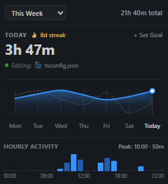
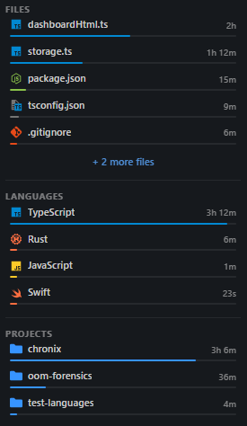
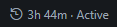

# Chronix

Track your coding time by file, language, and project in VS Code. All data stays locally on your computer.

## Preview

<p align="left">
  
</p>
<p align="left">
  
</p>
<p align="left">
  
</p>

## Installation

Install from the [VS Code Marketplace](https://marketplace.visualstudio.com/items?itemName=AdityaLF.chronix), or launch Quick Open (`Ctrl+P` / `Cmd+P`) in VS Code and run:

```bash
ext install AdityaLF.chronix
```

## Features

- Track time spent on each file, programming language, and project.
- View hourly coding activity and find your peak productive hours.
- View your daily and weekly activity for the last 4 weeks.
- Set daily coding goals.
- View 4-week summary stats, including daily average, peak day, longest streak, and active days.
- Search and filter through your tracked files, languages, and projects.
- Export reports to Markdown or CSV.
- Runs locally, with all data stored on your machine. No cloud accounts or telemetry.

## How It Works

1. Chronix starts tracking automatically as you write and edit code.
2. Tracking pauses automatically after 2 minutes of inactivity.
3. Data is stored locally in your VS Code global storage directory (`chronix-data.json`).

## Extension Settings

Configure Chronix under **Settings** (`Ctrl+,` / `Cmd+,` > search for `chronix`):

| Setting | Default | Description |
|---|---|---|
| `chronix.dailyGoal` | `0` | Daily coding goal (e.g. 2h, 30m, 1h 30m, 45s, or 0 to disable). Shows progress bar in Chronix |
| `chronix.notifyGoalAchieved` | `true` | Show a notification when your daily goal is reached |
| `chronix.initialItemsLimit` | `5` | Number of items (files, languages, projects) initially visible in the Chronix dashboard |
| `chronix.maxExpandedItems` | `10` | Maximum number of items (files, languages, projects) shown when expanding a list (+ more) in the Chronix dashboard |
| `chronix.ignoredPatterns` | `[".env", "node_modules"]` | List of file extensions, filenames, or folder patterns to ignore in Chronix tracking |

## Contributing

Contributions are welcome. See the [Contributing Guidelines](CONTRIBUTING.md) to get started.

## Acknowledgments

File and language icons provided by [Material Icon Theme](https://github.com/material-extensions/vscode-material-icon-theme).

## License

This project is licensed under the [MIT License](LICENSE).
